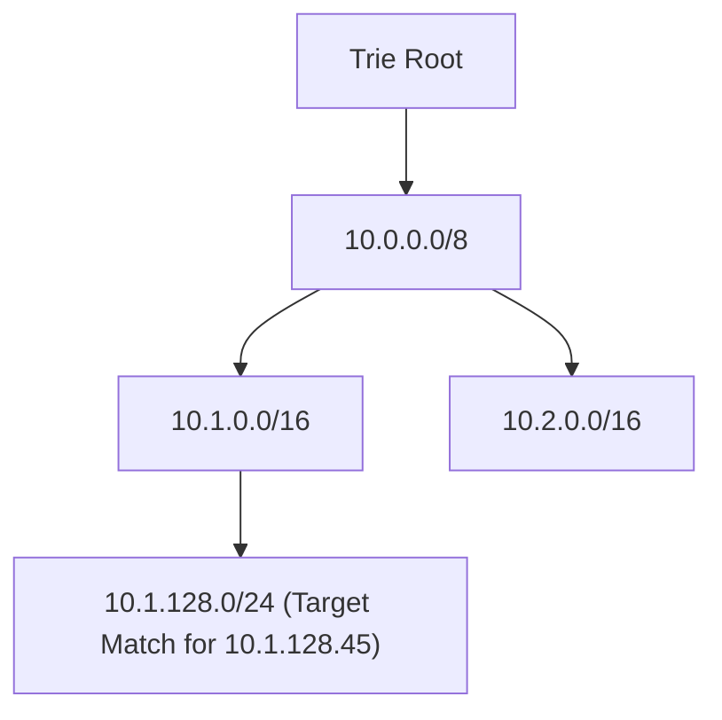

# Linux Kernel: eBPF LPM Trie Maps & Subnet Route Matching

The eBPF `BPF_MAP_TYPE_LPM_TRIE` data structure executes Longest Prefix Match (LPM) lookups in $O(W)$ time (where $W$ is key bitwidth), enabling line-rate routing table evaluation inside kernel networking programs.



---

## 1. Key Structure & Traversal

```c
struct bpf_lpm_trie_key {
    __u32 prefixlen; /* Number of significant bits */
    __u8 data[0];    /* Binary IP address bytes */
};
```

* **Longest Match Invariant:** When an incoming packet IP is queried, the trie traverses from root downward, returning the node with the largest `prefixlen` that matches the search key bits.
* **Concurrency:** Lookups run concurrently under RCU without requiring spinlocks, allowing lockless packet inspection at 100GbE line rates.
