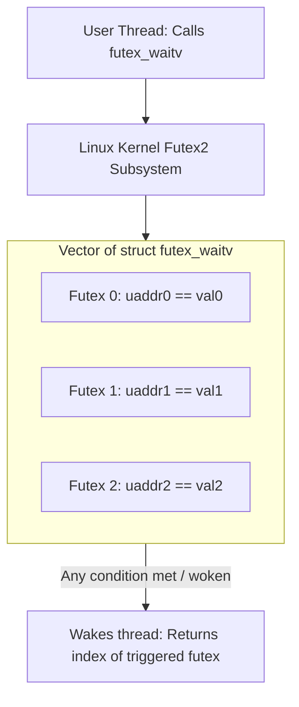

# Linux Kernel: Vectorized Synchronization with futex_waitv (futex2)

The `futex_waitv()` system call enables a user-space thread to atomically wait on an array of multiple distinct fast user-space mutexes (futexes), resolving longstanding `WaitForMultipleObjects` emulation bottlenecks.



---

## 1. Structure & Usage

```c
struct futex_waitv {
    __u64 val;    /* Expected value at uaddr */
    __u64 uaddr;  /* User-space address of 32-bit futex */
    __u32 flags;  /* FUTEX_32, FUTEX_PRIVATE_FLAG, etc. */
    __u32 __reserved;
};
```

* **Vectorized Efficiency:** Replaces complex multi-threaded polling loops or pipe multiplexing with a single direct kernel entry.
* **Atomicity:** The kernel verifies that all values match before enqueuing the sleeping task into respective hash buckets.
