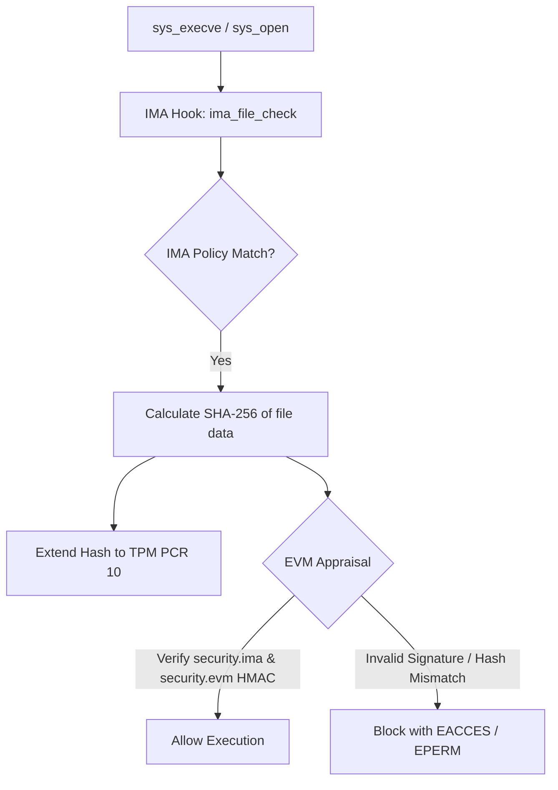

# Linux Kernel: Integrity Measurement Architecture (IMA) & EVM

The Linux Integrity Measurement Architecture (IMA) and Extended Verification Module (EVM) authenticate file contents and POSIX extended attributes before binary execution, blocking unauthorized software modifications.

---

## 1. Subsystem Roles

* **IMA-Measurement:** Maintains an append-only measurement log in kernel memory and extends file digests into TPM PCR 10 for remote attestation.
* **IMA-Appraisal:** Validates the cryptographic signature or hash stored in `security.ima` extended attribute against trusted kernel keyrings (`.ima`).
* **EVM (Extended Verification Module):** Protects file metadata (inodes, UID/GID, modes, and `security.ima` itself) against offline tampering by signing attributes with a hardware-backed HMAC (`security.evm`).
