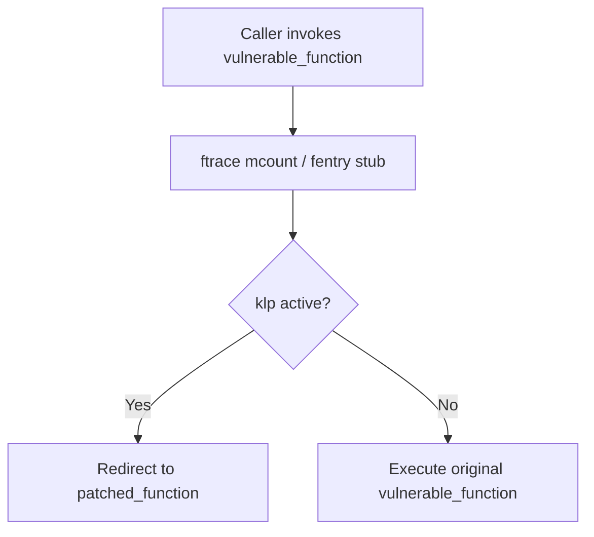

# Linux Kernel Live Patching Architecture (klp)

Enables security patching of running kernel code without requiring system reboots.

---

## 1. Consistency Model

Linux livepatching utilizes a per-task consistency model:
- Threads running during patch transition complete their current syscall before switching to the new version.
- Sleeping tasks switch execution to patched functions upon waking.
