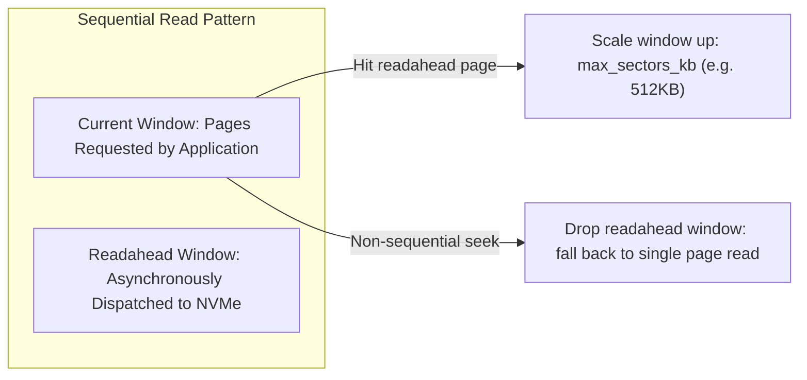

# Linux Kernel: Page Cache Readahead & Window Scaling

The Linux kernel file system layer optimizes sequential I/O by managing dynamic readahead windows, pre-fetching blocks into page cache before user applications request them.

---

## 1. Tuning & Invariants

* **`posix_fadvise()`:** Applications signal read patterns (`POSIX_FADV_SEQUENTIAL` doubles readahead window; `POSIX_FADV_RANDOM` disables readahead completely).
* **Asynchronous Flags:** The kernel flags the midpoint page with `PageReadahead`. Touching this page triggers the next background readahead burst without blocking the application.
