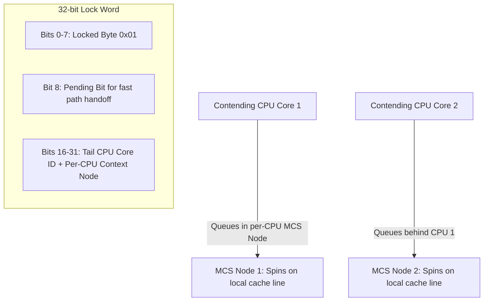

# Linux Kernel: Scalable Queued Spinlocks (qspinlock)

Queued spinlocks replace legacy ticket spinlocks, using an MCS queue array embedded within a single 32-bit atomic word to prevent cache-line bouncing across multi-socket NUMA systems.

---

## 1. Operating Phases

1. **Fast Path:** If the lock word is `0`, an incoming CPU executes `CAS(0, 1)` and claims ownership in one instruction.
2. **Pending Path:** If locked without contenders, a second CPU sets the `Pending` bit and spins on the main lock byte.
3. **Queued Path:** Subsequent contending cores enqueue into per-CPU MCS nodes, spinning strictly on their local CPU cache lines until the predecessor signals availability.
