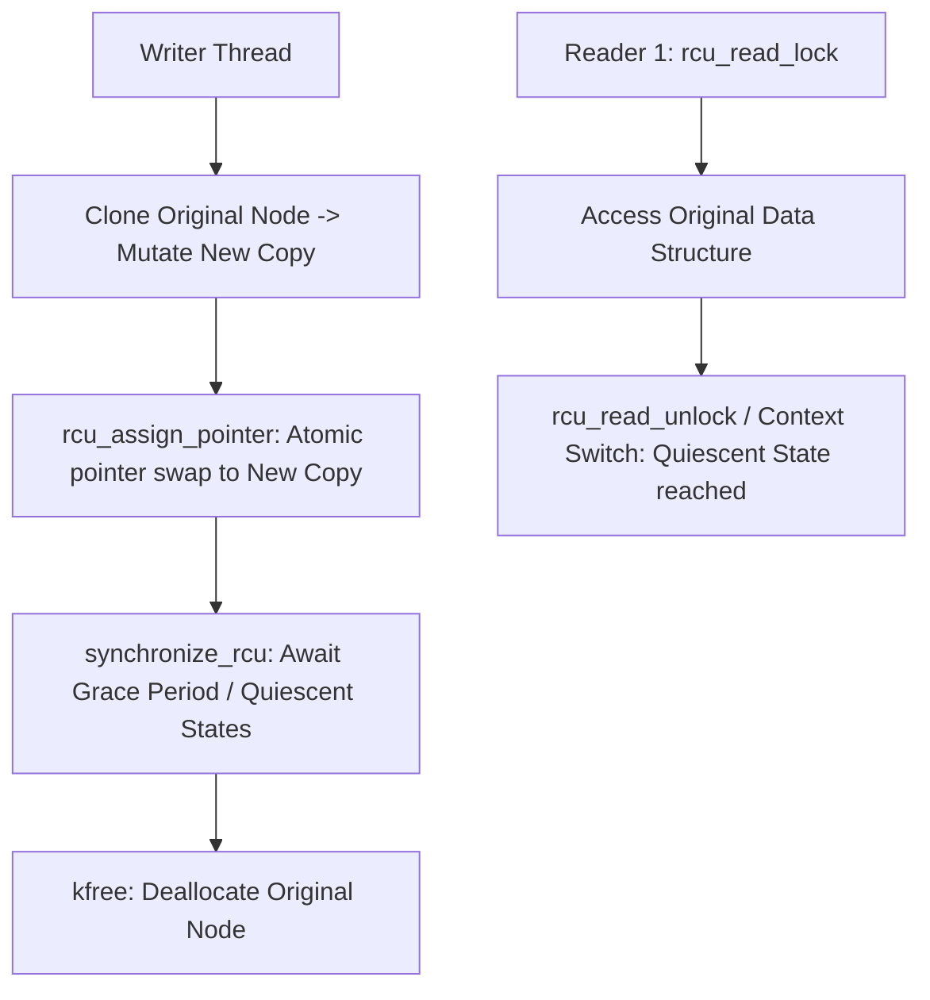

# Linux Kernel Read-Copy-Update (RCU) Architecture

RCU guarantees deterministic, zero-synchronization read access to shared kernel data structures by delaying memory reclamation until all pre-existing read-side critical sections complete a Grace Period.

---

## 1. Quiescent States

A quiescent state occurs on a CPU core when it is guaranteed not to hold references to pre-existing RCU read-side critical sections:
* CPU context switch (in non-preemptible RCU).
* Transition to userspace execution.
* CPU entering idle loop (`nohz`).
