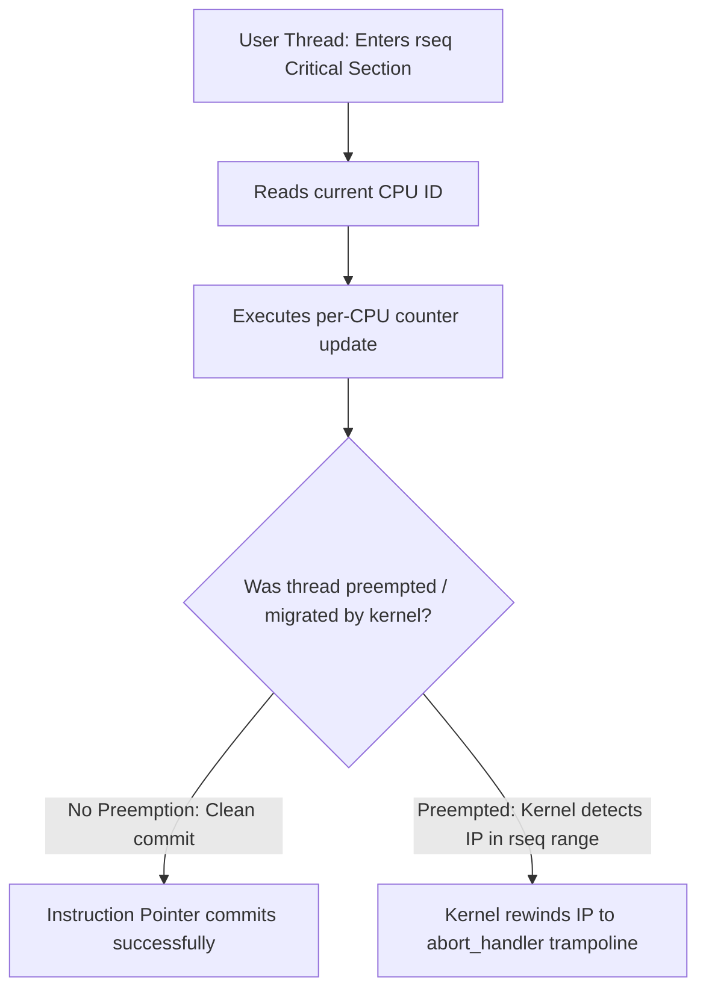

# Linux Kernel: Restartable Sequences (rseq) & Lock-Free Per-CPU Data

The `rseq()` system call allows user-space programs to execute atomic read-modify-write sequences on per-CPU data structures without CPU lock instructions (`LOCK CMPXCHG`) or memory barriers.

---

## 1. Architectural Components

* **Registration:** Threads register a `struct rseq` with the kernel via `rseq(2)`.
* **Critical Section Descriptors:**
  - `start_ip`: Memory offset of the critical section start.
  - `post_commit_offset`: Length of the critical section.
  - `abort_ip`: Target instruction address where the kernel rewinds execution if preemption or signal delivery interrupts the sequence.
* **Performance Gain:** Provides lockless per-CPU memory allocators and metrics counters at single-cycle hardware speeds.
