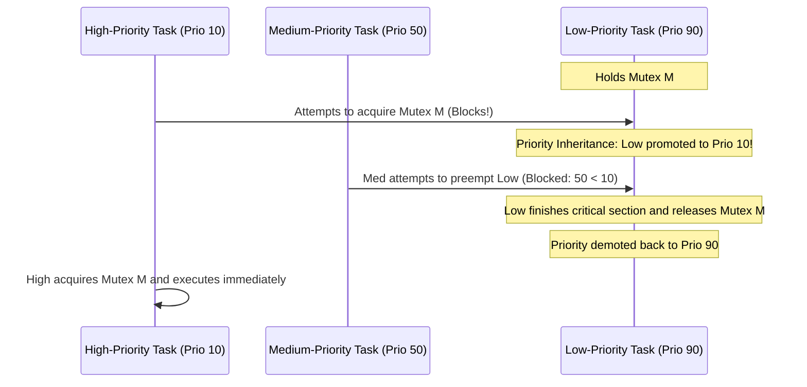

# Real-Time Linux: RT-Mutex & Priority Inheritance (PI) Protocol

Priority Inheritance eliminates unbounded priority inversion in real-time operating systems by temporarily elevating the priority of a low-priority lock holder to match the highest-priority blocked thread.

---

## 1. Deadlock Detection & Chaining

* **PI Chains:** If Task A blocks on Mutex 1 (held by B), and Task B blocks on Mutex 2 (held by C), priority boosts propagate transitively ($A 	o B 	o C$).
* **Deadlock Walk:** The kernel traverses wait-queues during lock contention; if a cyclic dependency ($C 	o A$) is detected, the call aborts immediately with `-EDEADLK`.
