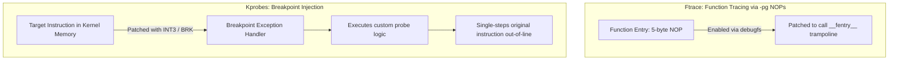

# Linux Kernel: Dynamic Instrumentation with Ftrace & Kprobes

Linux provides low-overhead kernel tracing through static tracepoints, dynamic function tracing (Ftrace), and arbitrary instruction patching (Kprobes).

---

## 1. Instrumentation Types

1. **Static Tracepoints:** Built-in conditional branch hooks placed by kernel developers; zero runtime overhead when disabled.
2. **Ftrace:** Compilers insert 5-byte `NOP` sequences at function entries (`-fpatchable-function-entry`), patched dynamically with jumps to tracers.
3. **Kprobes / Kretprobes:** Replaces target instruction bytes with breakpoint opcodes to intercept arbitrary kernel execution locations.
