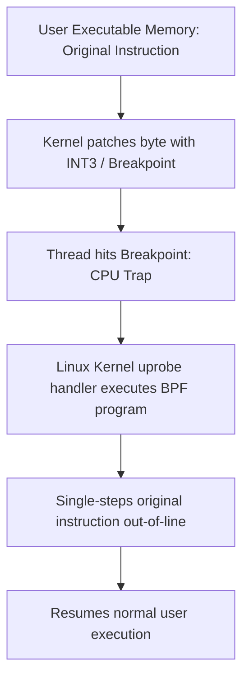

# Linux Tracing: User-Space Probes (uprobes & uretprobes)

User-space probes (`uprobes`) allow dynamic, non-intrusive instrumentation of user-space executables and shared libraries by patching instructions at runtime without recompilation.

---

## 1. Mechanics & Overhead

* **Instruction Patching:** The kernel replaces the first byte of the target virtual address with a software breakpoint (`INT3` on x86, `BRK` on ARM64) using Copy-on-Write page duplication.
* **`uretprobes` Trampoline:** Intercepts function returns by hijacking the return address on the stack and redirecting it to a kernel trampoline stub, recording function execution latencies.
* **Performance Consideration:** Incurs a full CPU exception context switch per probe hit; high-frequency loops prefer USDT (User Statically Defined Tracing) or eBPF tail calls.
