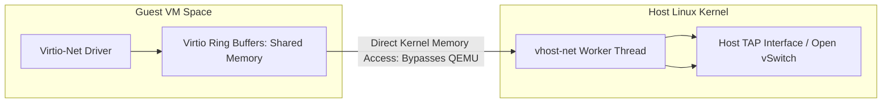

# Virtualization: Linux vhost-net In-Kernel Virtio Ring Offload

The `vhost-net` kernel module optimizes VM network performance by bypassing QEMU user-space process emulation, allowing guest virtio ring descriptors to be processed directly inside the host kernel.

---

## 1. Architecture Comparison

* **Standard Virtio (QEMU Emulation):** VM-Exit context switch $	o$ KVM kernel $	o$ QEMU user-space worker $	o$ write to TAP device. High latency and double context switching.
* **In-Kernel `vhost-net`:** Guest issues `ioeventfd` doorbell write $	o$ Host kernel `vhost` worker thread handles buffer dequeuing and packet injection directly into network stack, eliminating user-space round-trips.
