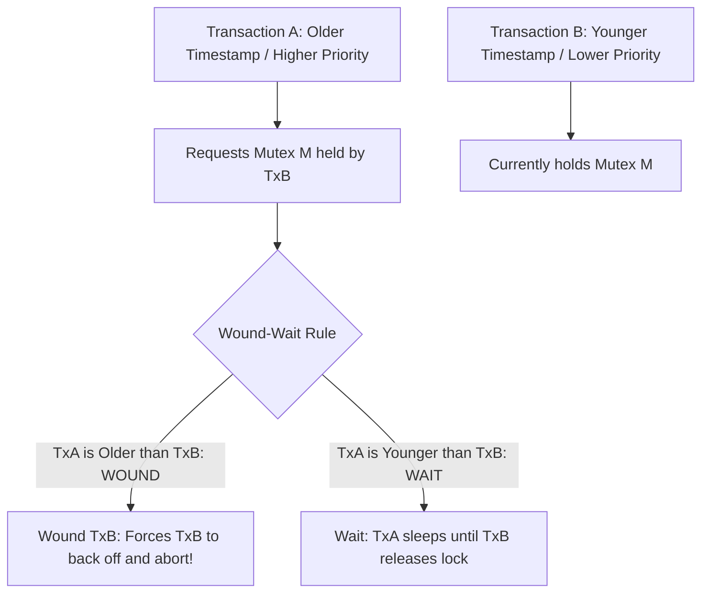

# Linux Kernel: Deadlock-Free Locking with Wound-Wait Mutexes (ww_mutex)

Linux `ww_mutex` (Wound-Wait Mutex) enables GPU drivers and subsystems to acquire arbitrary sets of shared buffers across unpredictable execution paths without deadlocks.

---

## 1. Algorithm Rules & Backoff Protocol

* **Wound-Wait Protocol:**
  - Older transactions **wound** younger transactions holding a desired lock, forcing the younger transaction to release all currently held locks and return `-EDEADLK`.
  - Younger transactions **wait** politely for older lock holders.
* **Backoff Loop:** When a transaction receives `-EDEADLK`, it releases all acquired locks in its context and re-acquires the contested lock using `ww_mutex_lock_slow()`.
