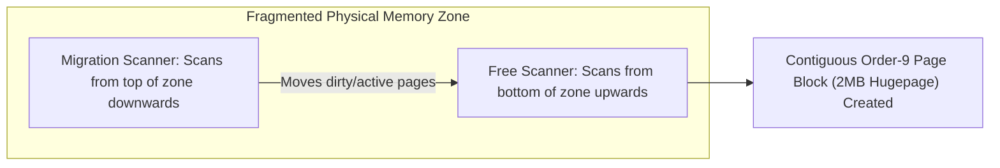

# Linux Memory Management: Compaction & Fragmentation Control

Linux memory compaction migrates movable physical pages to create contiguous high-order page blocks (e.g., 2MB hugepages) without discarding active page cache data.

---

## 1. Mechanism & Triggers

* **Dual Scanners:** The migration scanner scans for allocated movable pages; the free scanner scans for target empty frames. When scanners meet, the compaction pass terminates.
* **Proactive Compaction:** Controlled via `/proc/sys/vm/compaction_proactiveness`; triggers background `kcompactd` runs before high-order page allocation requests arrive.
