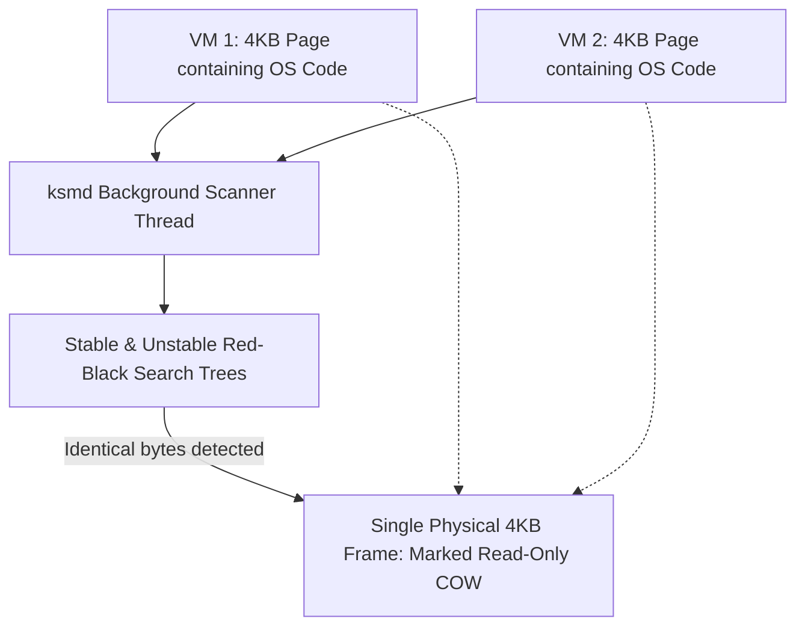

# Linux Memory Management: Kernel Samepage Merging (KSM)

Kernel Samepage Merging (KSM) is a host memory deduplication daemon (`ksmd`) that scans user memory pages, identifies identical data contents, and merges them into a single Copy-On-Write (COW) physical memory frame.

---

## 1. Operating Mechanics & Invariants

* **Opt-In Memory Regions:** Applications must register memory ranges explicitly via `madvise(addr, length, MADV_MERGEABLE)`.
* **Tree Structures:**
  - **Unstable Tree:** Holds candidate pages whose contents have not yet been observed across multiple scan intervals.
  - **Stable Tree:** Indexes already-merged, write-protected physical pages using content hashes.
* **Copy-On-Write Trigger:** Any write to a merged page triggers a page fault (`do_wp_page`), causing the kernel to duplicate the frame and restore private writable mappings.
