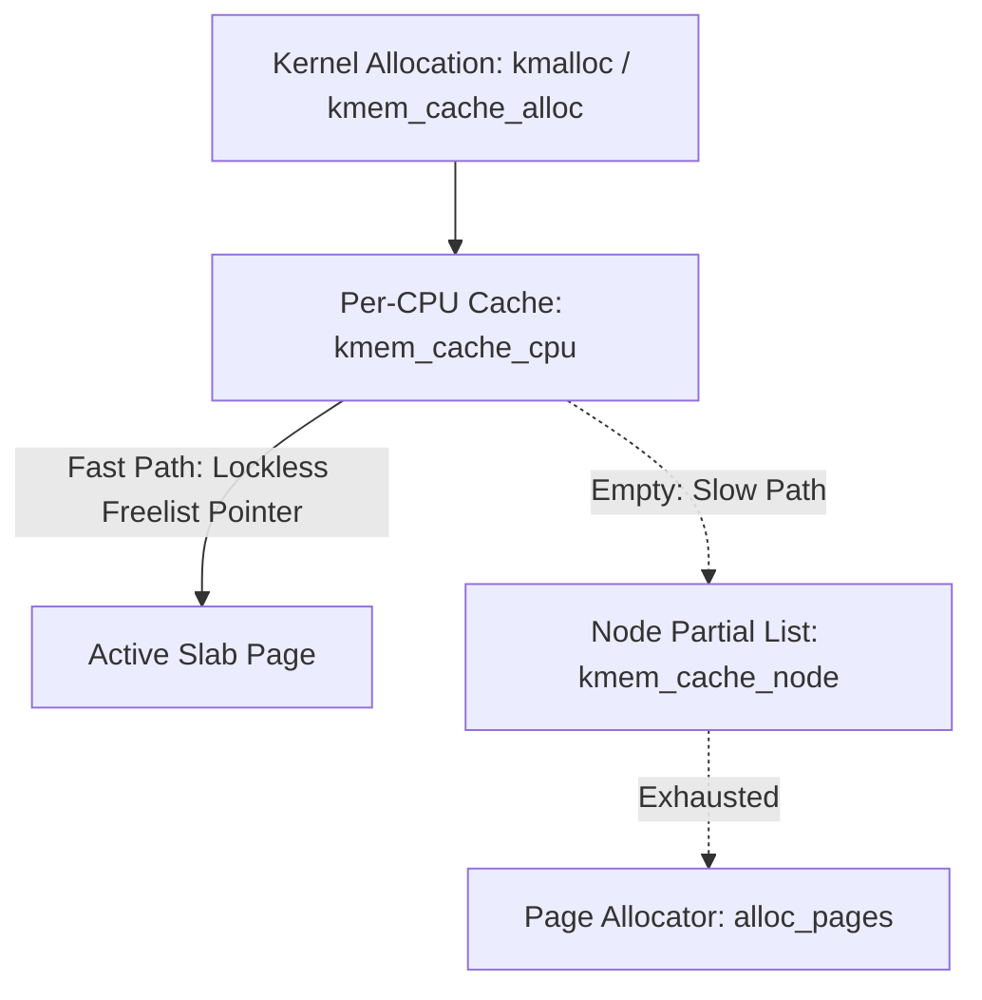

# Linux Kernel: SLUB Memory Allocator & Per-CPU Caches

The SLUB allocator provides low-overhead small-object memory allocation for kernel data structures (`struct task_struct`, `struct inode`), eliminating legacy SLAB queues and metadata overhead.

---

## 1. Structural Architecture

* **`kmem_cache_cpu` (Per-CPU Fast Path):** Threads allocate objects via atomic pointer swings (`freelist = *(void **)freelist`) without taking cross-core spinlocks.
* **In-Object Freelist Pointers:** Free object slots store pointers to the next free item directly inside their unallocated payload space, offset-obfuscated via random canaries (`CONFIG_SLAB_FREELIST_HARDENED`).
* **Page Struct Tracking:** SLUB stores slab state in `struct page` (now `struct slab`), avoiding external management object allocations.
