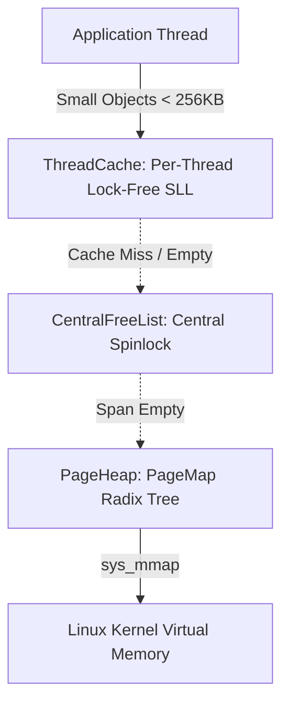

# Memory Management: Google TCMalloc Architecture

Google TCMalloc (Thread-Caching Malloc) eliminates multi-threaded heap contention using three allocation tiers: ThreadCache, CentralFreeList, and PageHeap.

---

## 1. Multi-Tiered Architecture

1. **ThreadCache:** Thread-local singly linked lists partitioned across size classes (8 bytes to 256KB); fast-path allocations require zero synchronization locks.
2. **CentralFreeList:** Balances memory distribution across threads; allocates and reclaims object batches using Span descriptors.
3. **PageHeap:** Manages memory in 4KB/8KB page spans using radix-tree page mapping for $O(1)$ object-to-span lookups.
