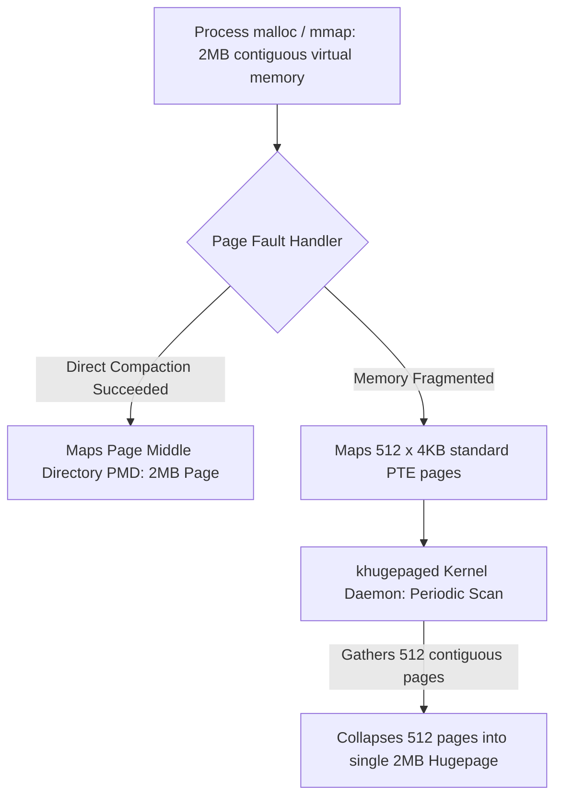

# Linux Memory Management: Transparent Hugepages (THP) & khugepaged

Transparent Hugepages (THP) optimize Translation Lookaside Buffer (TLB) hit rates by backing virtual memory ranges with 2MB physical page blocks instead of standard 4KB pages.

---

## 1. Tuning & Allocation Flags

* **Modes (`/sys/kernel/mm/transparent_hugepage/enabled`):**
  - `always`: Allocates 2MB hugepages for all eligible heap memory.
  - `madvise`: Restricts hugepages strictly to memory regions marked with `MADV_HUGEPAGE`.
  - `never`: Completely disables THP.
* **Latency Penalties:** Synchronous direct compaction can introduce millisecond-scale latency spikes on high-throughput database servers; production systems prefer `madvise` combined with background `khugepaged` collapsing.
