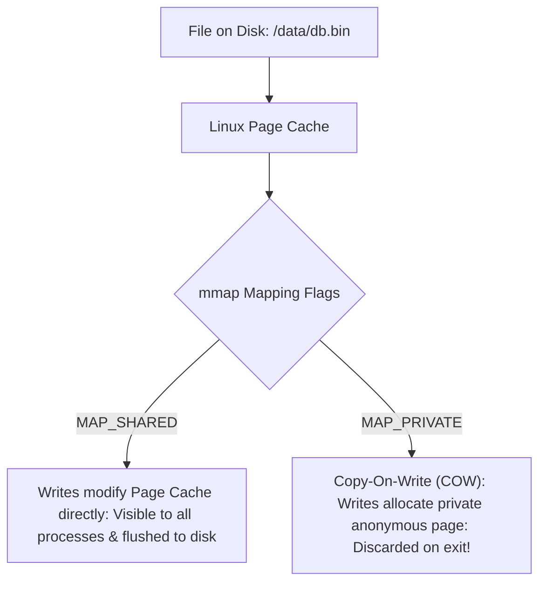

# Linux Virtual Memory: mmap() Flags and Copy-On-Write (COW) Semantics

The `mmap()` system call maps files directly into process address space with distinct sharing and persistence guarantees.

---

## 1. Fork Optimization
`fork()` maps all parent memory pages into the child as `MAP_PRIVATE` with read-only PTE flags. Only when either process writes to a page does a minor page fault allocate a physical copy.
