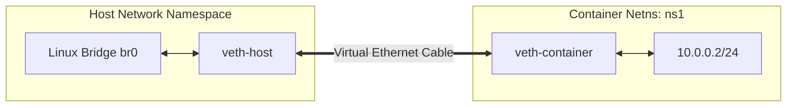

# Linux Network Namespaces & Virtual Ethernet (veth) Pairs

Network namespaces provide isolated instances of the Linux network stack (routing tables, firewall rules, network interfaces).



---

## 1. Configuration Commands

```bash
# Create namespace
ip netns add ns1

# Create veth pair
ip link add veth-host type veth peer name veth-guest

# Move peer into namespace
ip link set veth-guest netns ns1

# Configure IP addresses
ip addr add 10.0.0.1/24 dev veth-host
ip link set veth-host up

ip netns exec ns1 ip addr add 10.0.0.2/24 dev veth-guest
ip netns exec ns1 ip link set veth-guest up
```
