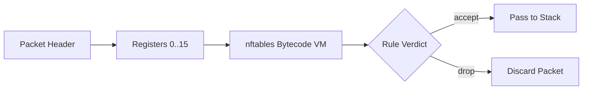

# Linux nftables Architecture & Bytecode Evaluation

`nftables` replaces iptables with an in-kernel register-based virtual machine evaluating packet payloads.

---

## 1. Architecture

- Unified tool and kernel module for IPv4, IPv6, ARP, and bridging.
- Atomic rule set updates without table flushing.
- Native set and dictionary indexing ($O(1)$ lookups for IP lists).
