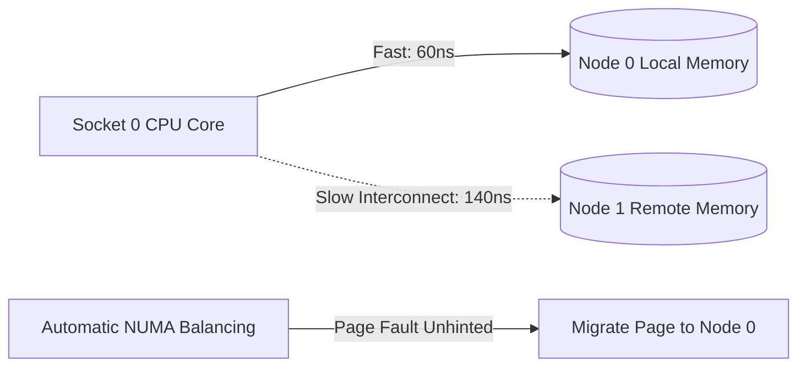

# Hardware Topology: Linux NUMA Architecture and Memory Locality

Non-Uniform Memory Access (NUMA) multi-socket systems feature local RAM with low latency and remote socket RAM with higher interconnect overhead (UPI/QPI).

---

## 1. Memory Policies
- `MPOL_BIND`: Strictly allocates from specified NUMA nodes only.
- `MPOL_INTERLEAVE`: Alternates allocations round-robin across nodes (common for shared memory caches).
