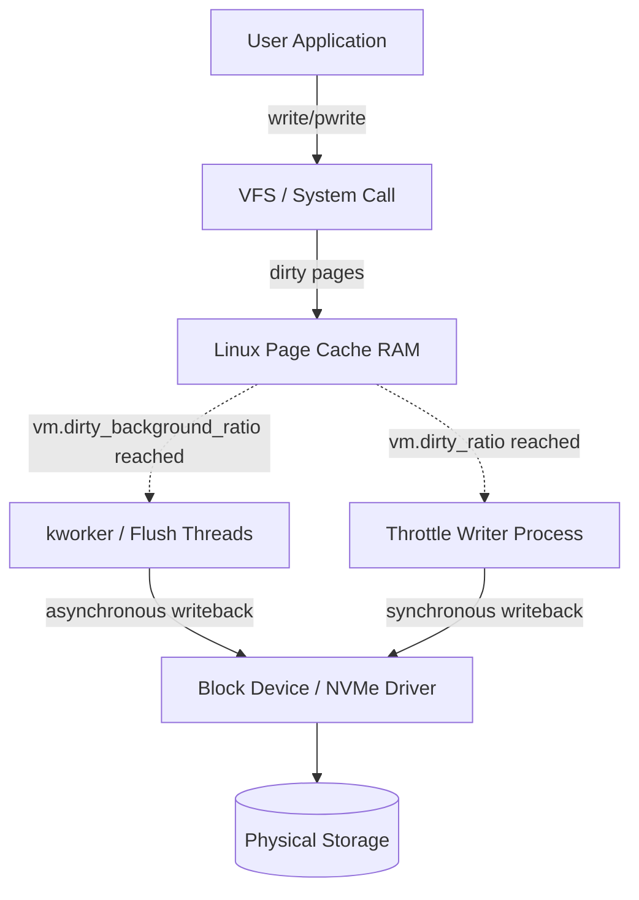

# Linux Page Cache Writeback Architecture

The Linux virtual memory subsystem buffers disk I/O in the page cache to minimize blocking block device operations.



---

## 1. Key Kernel Tuning Parameters

| Parameter | Default | Function |
|---|---|---|
| `vm.dirty_background_ratio` | 10% | Percentage of system memory filled with dirty pages where kernel background threads (`flusher`) begin asynchronous writeback to storage. |
| `vm.dirty_ratio` | 20% | Absolute percentage of system memory where active writing processes block and force synchronous writeback before issuing more writes. |
| `vm.dirty_background_bytes` | 0 | Byte-level alternative to `dirty_background_ratio`. Takes precedence if set non-zero. |
| `vm.dirty_bytes` | 0 | Byte-level alternative to `dirty_ratio`. Essential on large-memory systems (>128GB) to prevent multi-gigabyte stalls. |
| `vm.dirty_expire_centisecs` | 3000 (30s) | How old a dirty page can remain in memory before flusher threads flag it for mandatory writeback. |
| `vm.dirty_writeback_centisecs` | 500 (5s) | Interval at which kernel wakeup threads check for expired dirty pages. |

---

## 2. High-Throughput NVMe Database Optimization

On servers with large RAM allocations (e.g., 256GB RAM), default ratio thresholds cause write stalling because 20% equates to 51.2GB of dirty buffers flushing at once.

```bash
# Apply precise byte thresholds to prevent latency spikes
sysctl -w vm.dirty_background_bytes=268435456   # 256 MB
sysctl -w vm.dirty_bytes=1073741824             # 1 GB
sysctl -w vm.dirty_expire_centisecs=1500        # 15s
sysctl -w vm.dirty_writeback_centisecs=250       # 2.5s
```

---

## 3. Synchronous Flush System Calls

- `sync()`: Schedules all dirty file and filesystem metadata pages across the entire system for writeback.
- `fsync(int fd)`: Flushes all dirty pages and metadata associated with `fd` to durable physical media. Blocks until device confirms persistence.
- `fdatasync(int fd)`: Flushes file content pages and only metadata critical for subsequent data retrieval (e.g., file length), skipping non-essential metadata like `mtime`.
