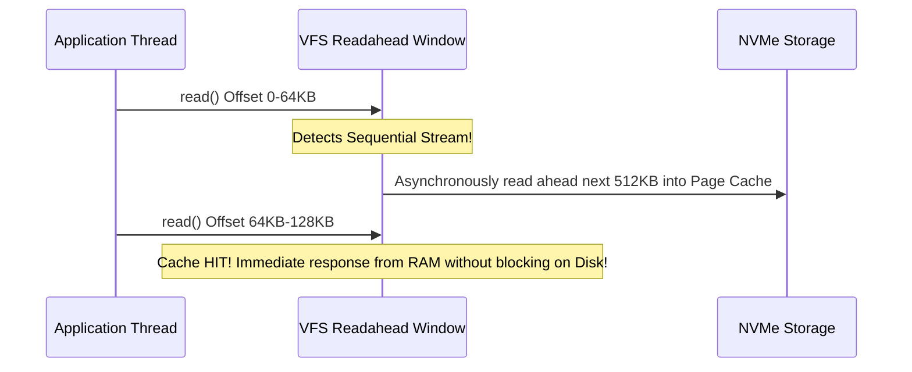

# Linux Filesystem: Page Cache Adaptive Readahead Architecture

The Linux kernel monitors file access patterns: detecting sequential reading triggers asynchronous readahead to fetch subsequent disk blocks into RAM before the application asks.

---

## 1. Application Hinting
Applications can override kernel heuristics with `posix_fadvise(fd, offset, len, POSIX_FADV_SEQUENTIAL)` to double the readahead window.
