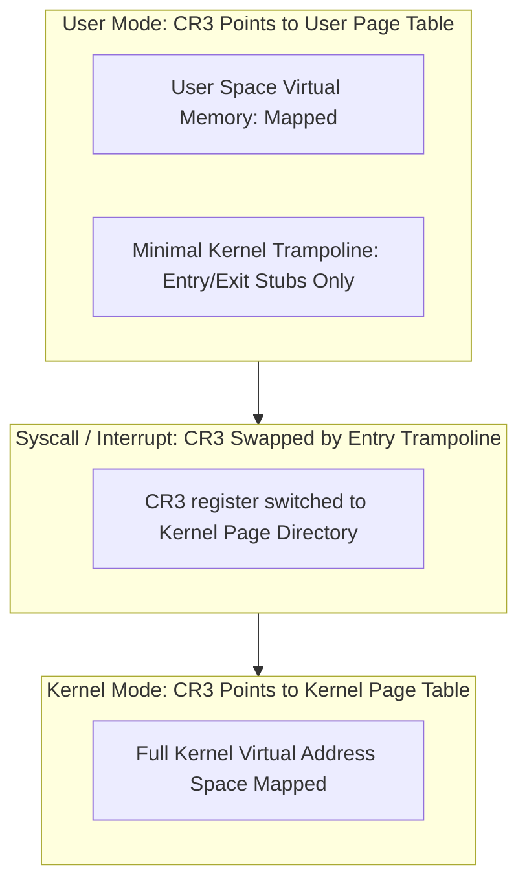

# Linux Kernel: Kernel Page Table Isolation (KPTI)

Kernel Page Table Isolation mitigates Meltdown (CVE-2017-5754) by separating user-space and kernel-space page tables, preventing rogue speculative execution across privilege rings.

---

## 1. Architectural Impact

* **Dual Page Directories:** Every process receives two PGDs: one for user-space execution (with only entry/exit trampolines mapped to kernel space) and one full PGD for supervisor execution.
* **TLB Flushing:** CR3 register writes trigger Translation Lookaside Buffer (TLB) invalidations. Linux utilizes Process-Context Identifiers (PCID) to preserve TLB entries across user/kernel switches.
