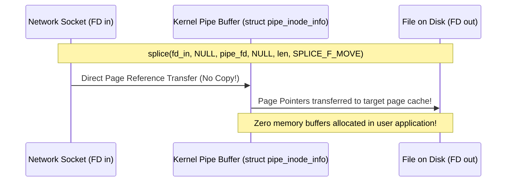

# Linux Zero-Copy: splice() and vmsplice() Kernel Pipeline

The `splice()` system call moves data between two file descriptors (where at least one is a pipe) without copying bytes into userspace memory.

---

## 1. Performance Impact
Splice reduces CPU usage by 60% compared to standard `read()` + `write()` loops for high-bandwidth proxy daemons (e.g. HAProxy).
