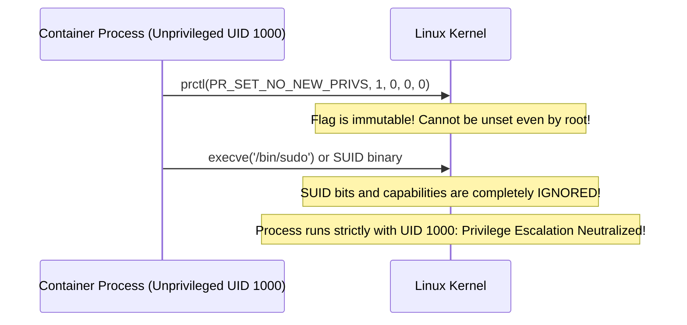

# Linux Security: PR_SET_NO_NEW_PRIVS and SUID Disabling

The `PR_SET_NO_NEW_PRIVS` flag ensures that a process and its children can never acquire additional privileges, even when executing `setuid` binaries.

---

## 1. Container Engine Default
Docker and Podman apply this flag before executing container entrypoints to prevent container breakouts via misconfigured SUID binaries on mounted volumes.
