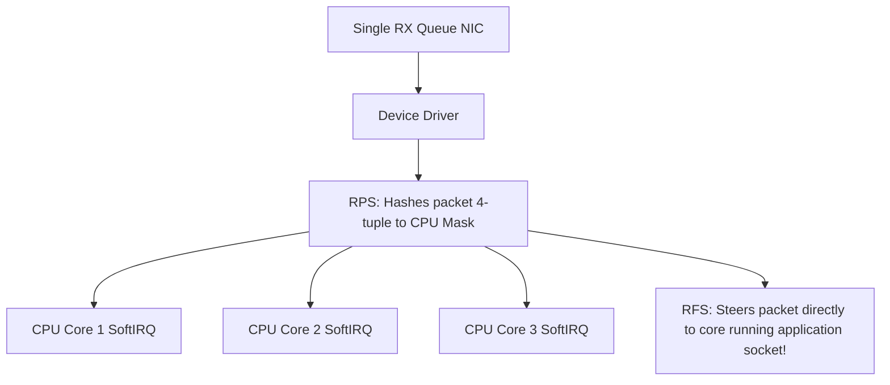

# Network Scale: RPS (Receive Packet Steering) & RFS Architecture

Receive Packet Steering (RPS) distributes packet processing across multiple CPU cores for single-queue network cards.

---

## 1. RFS Cache Locality
Receive Flow Steering (RFS) tracks which CPU core is actively reading the socket, routing packets to that exact core to keep CPU L1/L2 caches hot.
