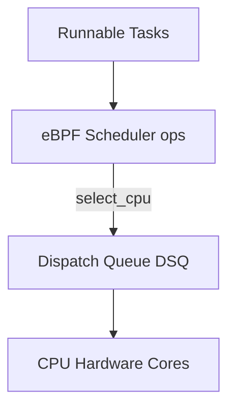

# Linux Kernel sched_ext Extensible eBPF Scheduler

Merged in Linux 6.12, `sched_ext` allows implementing CPU scheduling algorithms directly in eBPF without recompiling the kernel.

---

## 1. Key Callbacks

- `ops.select_cpu()`: Selects target CPU or dispatch queue (DSQ).
- `ops.enqueue()`: Enqueues task into a specific DSQ.
- `ops.dispatch()`: Moves tasks from custom DSQs into local execution queues.
