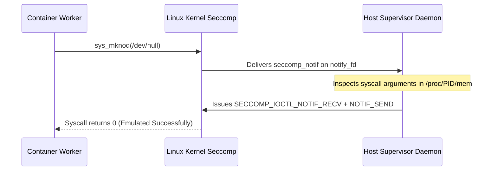

# Linux: Seccomp User Notification (SECCOMP_RET_USER_NOTIF)

Seccomp user notifications allow an unprivileged container process to delegate blocked system calls to an external supervisor process over a UNIX domain socket.

---

## 1. Capabilities & Pitfalls

* **Privileged Emulation:** Allows rootless containers to run operations like `mount()` or `mknod()` through host supervisor delegation.
* **TOCTOU Guard:** Kernel requires `SECCOMP_IOCTL_NOTIF_ID_VALID` checks to ensure the target process did not terminate or swap memory during inspection.
