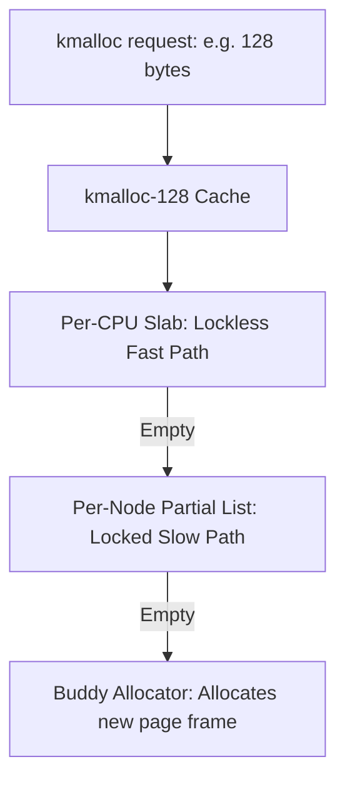

# Kernel Internals: SLUB Allocator vs Legacy SLAB

The SLUB allocator is the default Linux kernel slab allocator, eliminating complex per-CPU object queues and queues-of-queues found in legacy SLAB.

---

## 1. Fast Path vs Slow Path
- **Fast Path:** Uses atomic cmpxchg on per-CPU slab pointer without taking any spinlocks.
- **Slow Path:** Acquires the per-node partial spinlock to obtain a new page of objects.
