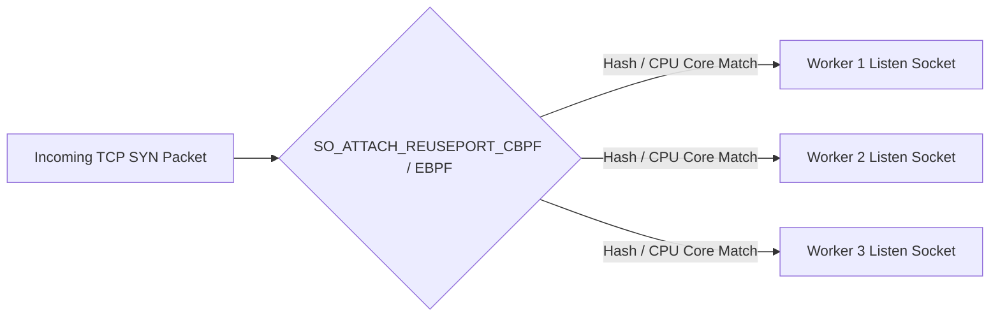

# High-Concurrency Sockets: SO_REUSEPORT and eBPF Packet Steering

`SO_REUSEPORT` allows multiple server threads or worker processes to bind to the exact same TCP/UDP port, eliminating accept mutex contention.

---

## 1. NUMA & CPU Affinity Steering
Using `SO_ATTACH_REUSEPORT_EBPF`, packets arriving on a specific NIC queue can be steered directly to the worker thread running on the local NUMA socket, achieving zero cross-socket cache thrashing.
