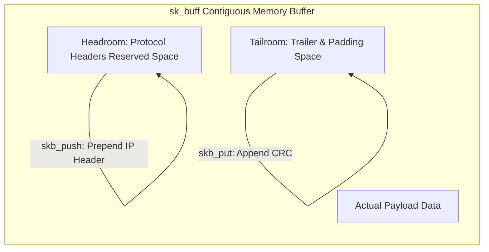

# Linux Network Stack: struct sk_buff Memory Architecture

The `sk_buff` (socket buffer) represents a network frame traversing the kernel, structured with headroom and tailroom to avoid memory reallocations during packet encapsulation.

---

## 1. Cloning vs Copying
- `skb_clone()`: Copies only the `sk_buff` metadata descriptor while sharing the packet payload buffer (using reference counting).
- `skb_copy()`: Fully duplicates both descriptor and underlying packet payload.
