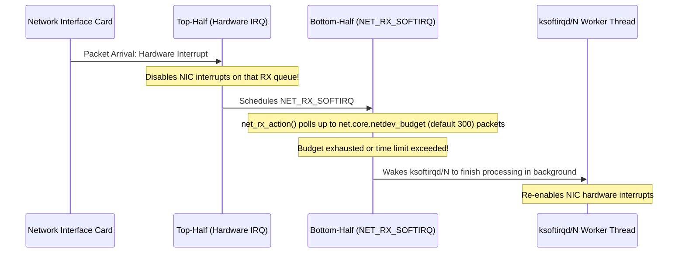

# Linux Network Stack: Softirq Processing Budget and NAPI Polling

Network packet ingress uses the New API (NAPI) polling loop to prevent interrupt storms from overwhelming the host CPU.

---

## 1. Tuning Packet Drops
When `/proc/net/softnet_stat` column 3 increments, packets are being dropped due to budget exhaustion. Increase `net.core.netdev_budget = 600`.
