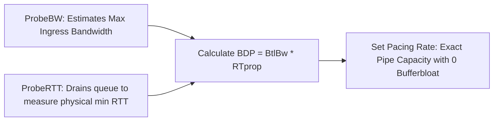

# High-Performance Networking: TCP BBR Congestion Control

Google BBR (Bottleneck Bandwidth and RTT) models the physical network pipe rather than treating packet loss as a congestion indicator like legacy Cubic.

---

## 1. BDP Principle
By pacing packets at exactly the bottleneck bandwidth, BBR prevents queues from building up in router buffers, eliminating latency bloat on high-throughput networks.
