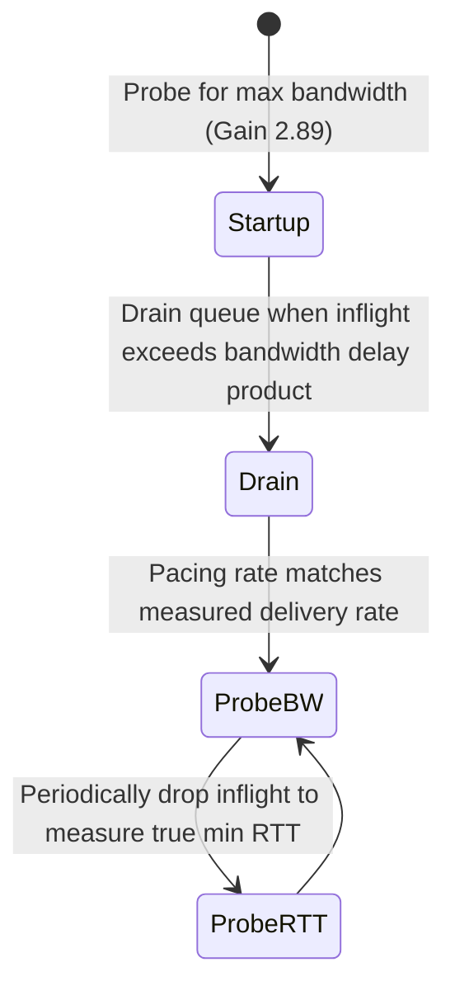

# TCP: BBRv3 Congestion Control Architecture

BBRv3 (Bottleneck Bandwidth and Round-trip propagation time) regulates sending rates using state machine models of the network path rather than reacting to packet drops like loss-based algorithms.

---

## 1. Core Model Parameters

1. **$BtlBw$ (Bottleneck Bandwidth):** Estimated by tracking maximum delivery rate over a sliding time window (typically 10 round trips).
2. **$RTprop$ (Round-Trip Propagation Time):** Measured by recording the minimum observed RTT over a 10-second window during which sending volume is constrained.
3. **BDP (Bandwidth Delay Product):** $BtlBw 	imes RTprop$ defines the exact volume of data that can be in flight without bufferbloat queueing.
