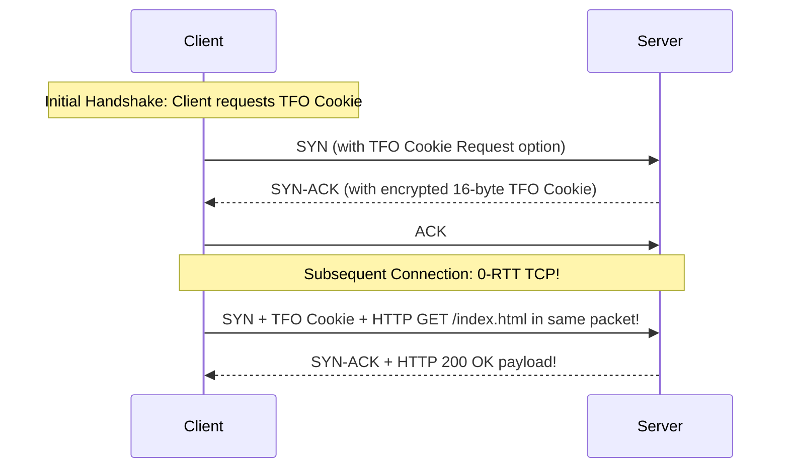

# Web Latency: RFC 7413 TCP Fast Open (TFO) Architecture

TCP Fast Open enables data payload transmission directly inside the initial `SYN` packet, saving one full round-trip time (1 RTT) during HTTP connection setup.



---

## 1. sysctl Activation
```bash
echo 3 > /proc/sys/net/ipv4/tcp_fastopen # Enables client (1) and server (2) TFO
```
