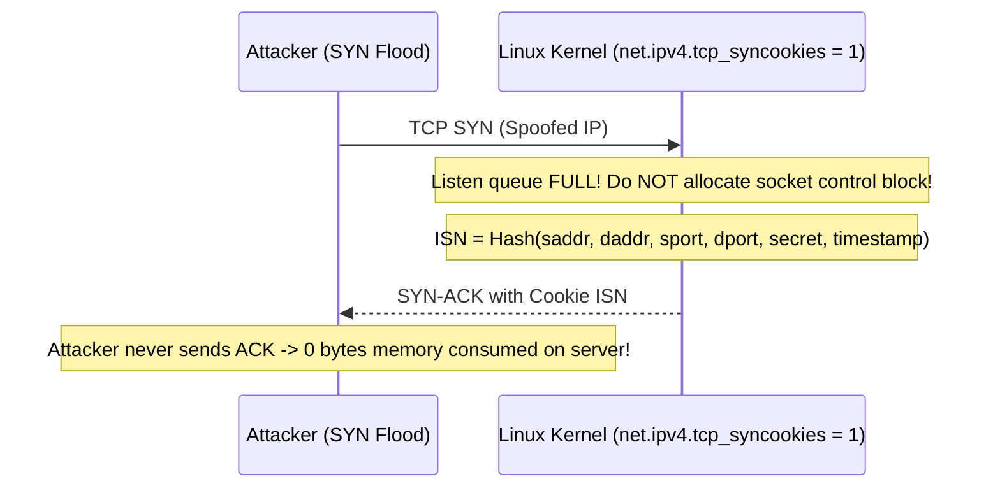

# Network Hardening: TCP SYN Cookie State-Free Handshakes

Under SYN flood attacks, the Linux kernel TCP listen backlog overflows. SYN cookies eliminate the half-open state table by encoding connection state into the Initial Sequence Number (ISN).

---

## 1. Cryptographic Invariants
When a legitimate client responds with final ACK, the acknowledgment number is `ISN + 1`. The kernel recomputes the hash; if verified, it instantiates the socket struct on demand.
