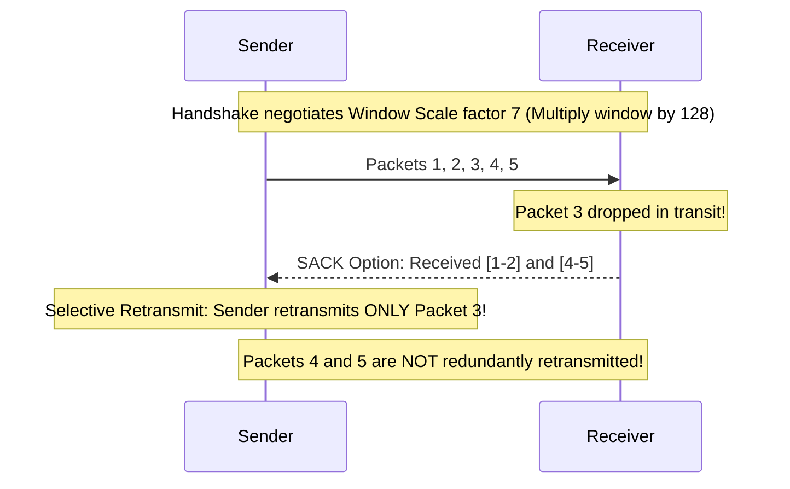

# TCP Internals: RFC 7323 Window Scaling and RFC 2018 SACK

Standard 16-bit TCP header limits receive window to 64KB. Window Scaling extends maximum window size to 1GB, essential for long-fat networks (LFN).

---

## 1. Throughput Formula
$$\text{Max Throughput} = \frac{\text{Window Size}}{\text{RTT}}$$
With a 64KB window on a 100ms transatlantic link, max speed is capped at 5.2 Mbps regardless of 10Gbps fiber capacity. Window scaling removes this ceiling.
