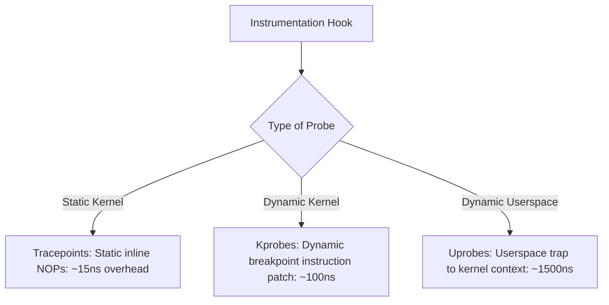

# Kernel Tracing: Tracepoints, Kprobes, and Uprobes Overhead

Dynamic tracing allows deep kernel inspection with eBPF, but choice of instrumentation hook dictates overhead and safety.

---

## 1. Production Guidance
- Prefer static **Tracepoints** (`sched:sched_switch`, `syscalls:sys_enter_*`) in hot paths.
- Avoid high-frequency **Uprobes** (>100k calls/sec) without BPF uprobe-multi optimizations.
