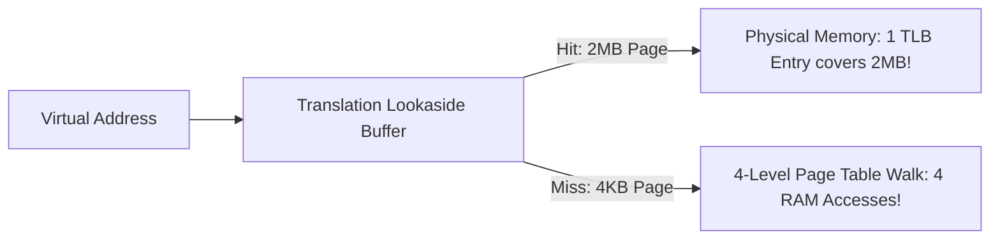

# Linux Memory Management: THP vs Hugetlbfs Architecture

Standard Linux x86_64 pages are 4KB. Databases like Redis and PostgreSQL frequently suffer TLB cache thrashing without 2MB hugepages.

---

## 1. Tradeoffs

| Feature | Transparent Hugepages (THP) | Hugetlbfs (Explicit) |
| :--- | :--- | :--- |
| **Allocation** | Automatic by kernel | Pre-allocated at boot / sysctl |
| **Defragmentation Cost** | Background `khugepaged` latency spikes | Zero runtime defragmentation cost |
| **Recommendation** | Disable for Redis/MongoDB (`madvise`) | Preferred for High-Performance DBs |
