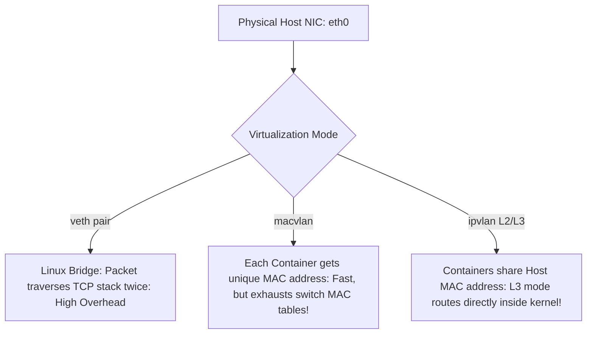

# Linux Networking: Container Virtual Interfaces Comparison

Container network plugins (CNIs) choose between virtual ethernet pairs, macvlan, and ipvlan based on performance and MAC table limits.

---

## 1. IPVLAN L3 Advantage
Eliminates ARP broadcast storms and MAC table limits on underlying datacenter switches while delivering near-native bare-metal packet performance.
