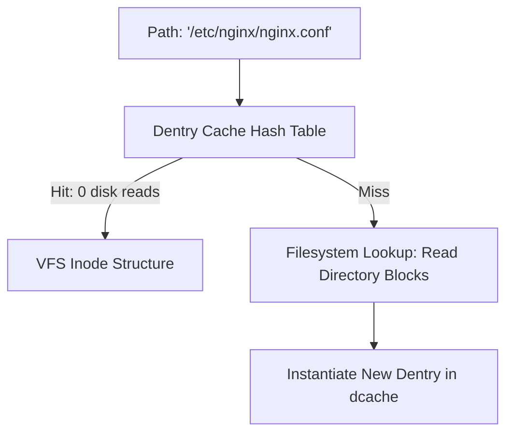

# Linux Filesystem: VFS Dentry Cache (dcache) and Inode Architecture

The Virtual File System caches directory entries (dentry) in RAM to avoid repetitive disk block lookups during path resolution like `/var/log/app/stdout.log`.

---

## 1. vfs_cache_pressure Tunable
- `vm.vfs_cache_pressure = 100`: Default fair reclamation between page cache and dentries/inodes.
- Lower values (e.g. 50): Instructs kernel to retain dentries in memory longer, speeding up file traversal operations.
