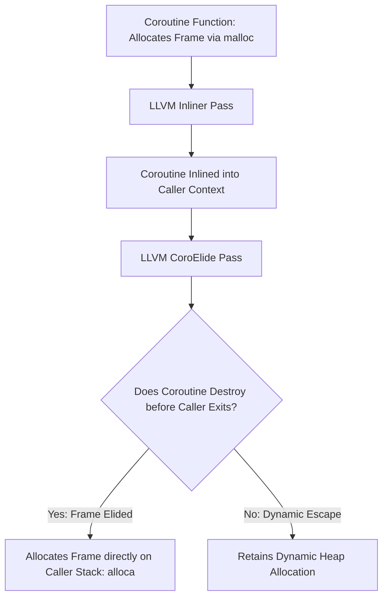

# Compiler Optimization: LLVM Coroutine Frame Elision (HALO)

LLVM Coroutine Frame Elision (Heap Allocation of Lookup Objects - HALO) optimizes C++20 and asynchronous coroutines by inlining coroutine state machines into callers and allocating frames on the stack.

---

## 1. Elision Invariants

1. **Ramp Function Inlining:** The coroutine's initialization ramp function must be fully inlined into the caller function.
2. **Dominance Proof:** The compiler must prove that the coroutine destruction point (`coro.destroy`) post-dominates all resumption points and is reached before the caller stack frame unwinds.
3. **Zero Heap Allocation:** Eliding the frame converts dynamic memory calls (`operator new`) into cheap stack allocations (`alloca`), accelerating coroutines to raw function call speeds.
