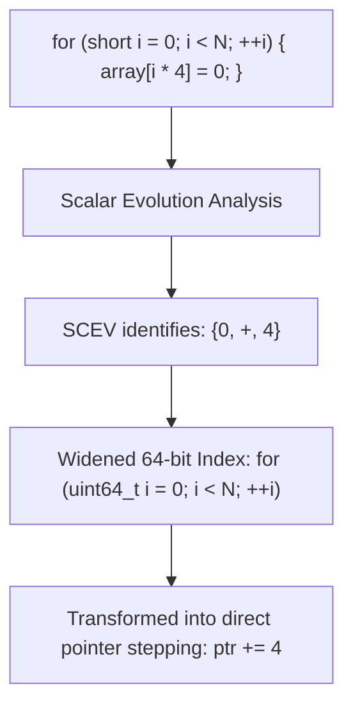

# Compiler Optimization: LLVM Induction Variable Simplification (IndVars)

LLVM `IndVarSimplify` canonicalizes loop induction variables using Scalar Evolution (SCEV), eliminating redundant index counters, widening bitwidths, and simplifying loop exit comparisons.

---

## 1. Optimization Transforms

* **Sign/Zero Extension Elimination:** Widens 16-bit or 32-bit loop induction counters to target register bitwidth (64-bit) when SCEV proves overflow is impossible (`nuw` / `nsw`), eliminating per-iteration sign-extension instructions.
* **Strength Reduction:** Replaces expensive loop multiplication (`i * 8`) with incremental additions (`base += 8`).
* **Exit Count Invariance:** Replaces dynamic loop condition evaluations with precalculated loop trip constants whenever induction bounds are provable at compile time.
