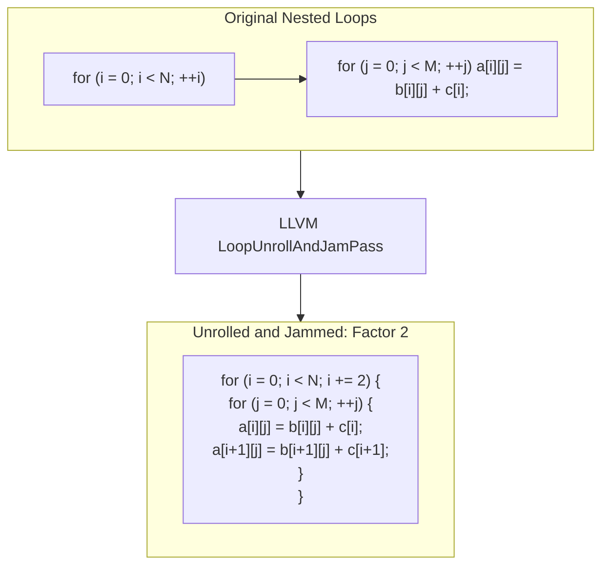

# Compiler Optimization: LLVM Loop Unroll-and-Jam

Loop Unroll-and-Jam unrolls an outer loop by a factor $K$ and fuses (jams) the resulting duplicate inner loop bodies together, maximizing CPU register reuse across multi-dimensional arrays.

---

## 1. Optimization Benefits

* **Register Reuse:** Values dependent on outer loop indices (e.g., array pointers, constants) stay pinned in hardware registers across the combined inner loop iterations.
* **Safety Invariant:** Legal only if no backward loop-carried data dependencies exist between outer and inner loop bodies.
