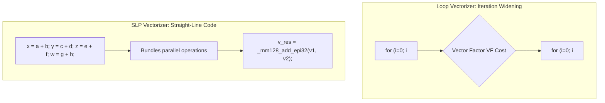

# Compiler Optimization: LLVM Loop Vectorizer & SLP Vectorization

LLVM maximizes SIMD throughput using two complementary vectorizers: the Loop Vectorizer (widening loop bodies) and the Superword-Level Parallelism (SLP) Vectorizer (combining isomorphic scalar instruction trees).

---

## 1. Vectorization Prerequisites

* **Trip Count & SCEV:** Scalar Evolution (SCEV) calculates exact or minimum trip counts to construct safe vectorized loops alongside scalar cleanup tails.
* **Alias Analysis:** Memory references must be proven independent or guarded with runtime pointer checks (`ptr_a + len < ptr_b`).
* **Reduction Detection:** Recognizes scalar accumulators (`sum += arr[i]`) and transforms them into horizontal vector add reductions.
