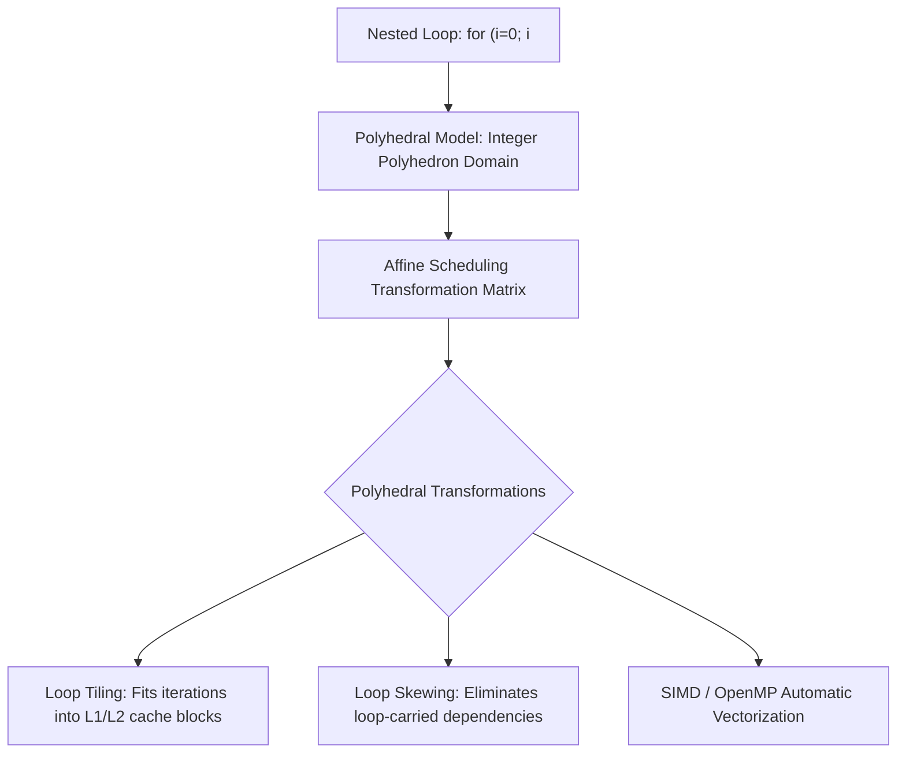

# Compiler Optimization: LLVM Polly Polyhedral Loop Transformations

LLVM Polly models nested loop iterations as integer points within multidimensional polyhedra (Z-polyhedra), applying linear matrix transformations to optimize cache locality and parallelism.

---

## 1. Polyhedral Representation

* **Iteration Domain ($D$):** System of affine inequalities representing loop bounds:

$$\mathcal{D} = \{ ec{i} \in \mathbb{Z}^n \mid A ec{i} + ec{b} \ge 0 \}$$

* **Access Relations ($R$):** Maps iteration points to target array memory locations.
* **Dependency Polyhedra:** Identifies Read-After-Write (RAW) data hazards. Any matrix transformation $T$ that preserves dependency vector positivity ($T ec{d} > 0$) represents a semantically valid loop restructuring.
