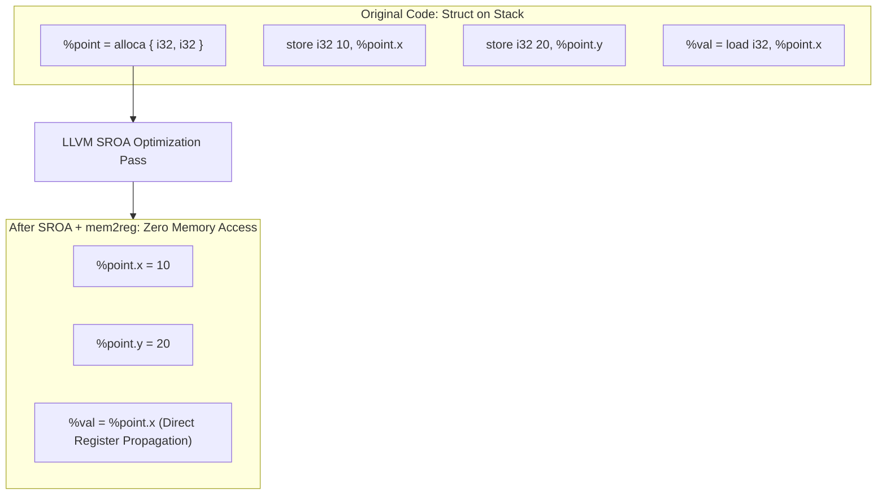

# Compiler Optimization: LLVM SROA (Scalar Replacement of Aggregates)

LLVM SROA dismantles aggregate variables (C `struct`, C++ classes) allocated in memory into discrete scalar variables, enabling `mem2reg` to promote stack memory loads into SSA virtual registers.

---

## 1. Optimization Pipeline

1. **Partition Analysis:** Inspects all `GetElementPtr` (GEP) instructions referencing an `alloca`, determining byte slices accessed by the program.
2. **Slicing:** Breaks monolithic allocations into independent scalar `alloca` instances for each non-overlapping field.
3. **Register Promotion (`mem2reg`):** Promotes newly generated independent scalar allocas directly into SSA values (`%1`, `%2`), converting memory traffic into register operations.
