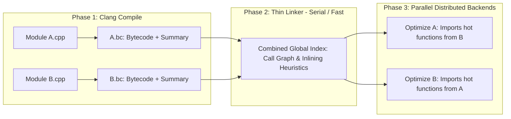

# Compiler Optimization: LLVM ThinLTO Distributed Cross-Module Inlining

ThinLTO combines whole-program Link-Time Optimization (LTO) effectiveness with standard modular compilation scalability by utilizing compact module summaries for cross-module decisions.

---

## 1. Operating Phases

1. **Summary Generation:** Compilers generate lightweight summaries (call graphs, referenced symbols, instruction counts) for each translation unit without linking giant monolithic IR graphs.
2. **Thin Link Phase:** Reads summaries into memory in milliseconds, resolves whole-program call graphs, and decides which functions to import across module boundaries.
3. **Parallel Backend Phase:** Independent backend worker threads load only imported bytecode definitions, performing dead-code stripping and cross-module inlining in parallel across all CPU cores.
